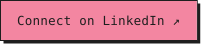
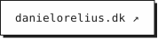
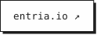

  
  
  
  

**Currently** co-founder & CEO at [Entria](https://entria.io), building Azure operations that run on a platform instead of on people.

The full story is at <a href="https://danielorelius.dk">danielorelius.dk</a> ↗
